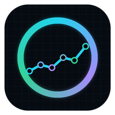
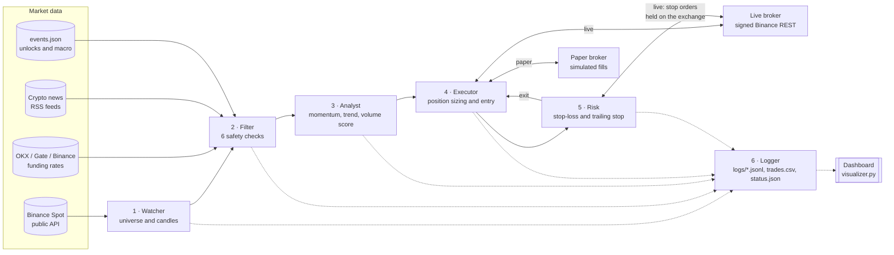

<div align="center">



# Crypto Desk

**A transparent, six-agent trading desk for Binance Spot: paper trading by default, exchange-side stop-losses, trailing stops and a live dashboard.**

[](https://github.com/ramz1ss/crypto-desk/actions/workflows/ci.yml)
[](LICENSE)
[](https://www.python.org/downloads/)
[](https://github.com/astral-sh/ruff)
[](docs/paper-vs-live.md)

[Quickstart](#quickstart) · [How it works](#how-it-works) · [Configuration](docs/configuration.md) · [Paper vs live](docs/paper-vs-live.md) · [Risk management](docs/risk-management.md) · [FAQ](#faq)

</div>

> [!CAUTION]
> **Not financial advice. Use at your own risk.** Trading cryptocurrency involves substantial risk of loss, and you can lose some or all of the money you trade. This software comes with **no warranty** and **no promise of profit**. Past or simulated results do not predict future results. Read the [full disclaimer](#disclaimer) before using it with real money.

---

## What is it?

Crypto Desk is a small, readable Python application that runs a complete trading loop on Binance Spot (USDT pairs). Every few minutes six specialised "agents" work as a pipeline: they watch the market, reject risky coins, score the remaining ones, size a trade, protect it with a stop-loss **before** it is opened, and record every decision.

It is **rule-based and fully deterministic**: no black-box AI, no hidden signals, no cloud service. Every rejected coin is logged with the exact check it failed, so you can audit why the desk did, or did not, trade.

It starts in **paper mode** (simulated money on real public market prices, no API keys). Live trading is disabled until you opt in explicitly.

## Features

- **Six-agent pipeline**: Watcher → Filter → Analyst → Executor → Risk → Logger ([architecture](docs/architecture.md)).
- **Paper trading first**: realistic simulation with fees, lot sizes, minimum notionals and 1-minute candle stop checks.
- **Exchange-side protection in live mode**: the stop-loss order is placed on Binance immediately after each fill (`STOP_LOSS_LIMIT` or OCO), so a position stays protected even if your PC or the desk goes offline.
- **Trailing stop** that only ratchets up once a trade is in profit.
- **Six safety filters**: bid/ask spread, perpetual funding rate, volume versus the 10-day average, order-book depth, negative news headlines (hack, exploit, delisting, ...) and a calendar of token unlocks and macro events (FOMC, CPI, ...).
- **Symbol allowlist** that matches a Binance API-key whitelist: orders for any other symbol are refused before they reach the exchange.
- **Restart-safe**: every order uses a `desk`-prefixed client id, and the state is reconciled with the real account and its open orders on every start. Holdings the desk did not buy are never touched.
- **Pre-flight check** before live trading: keys, clock sync, account permissions, withdrawals disabled, IP restriction, free balance.
- **Live dashboard** (`visualizer.py`): a local web app showing equity, P&L, open positions and each scan flowing through the agents, with an optional phone view on your Wi-Fi.
- **Manual controls**: stop, pause new entries, resume, or close open trades now.
- **Plain files, no database**: JSON Lines and CSV logs you can open in any tool.
- **Minimal dependencies**: Python standard library plus `requests`.
- **One-click Windows launchers**, plus shell scripts and a systemd unit for macOS and Linux.

## How it works



| # | Agent | Responsibility | Code |
|---|-------|----------------|------|
| 1 | **Watcher** | Builds the universe (BTC/ETH/BNB + top USDT alts by 24h volume, or your allowlist), drops stablecoins, leveraged and tokenised-stock symbols, fetches books and 1h/1d candles. | [`desk/watcher.py`](desk/watcher.py) |
| 2 | **Filter** | Rejects any candidate that fails spread, funding, volume, depth, news or event checks, and logs every failed reason. | [`desk/filter.py`](desk/filter.py) |
| 3 | **Analyst** | Scores survivors from 0 to 1: momentum (6h/24h returns, RSI), trend (EMA20/EMA50) and volume. Below `min_score` is rejected. | [`desk/analyst.py`](desk/analyst.py) |
| 4 | **Executor** | Sizes and opens at most one new position per cycle, respecting lot size, minimum notional, cooldowns and position limits. | [`desk/executor.py`](desk/executor.py) |
| 5 | **Risk** | Sets the initial stop **before** entry, then trails it upward once the trade is in profit. In live mode it moves the real stop order on Binance. | [`desk/risk.py`](desk/risk.py), [`desk/live.py`](desk/live.py) |
| 6 | **Logger** | Writes every rejection, skip, cycle and trade to plain files and keeps `status.json` up to date for the dashboard. | [`desk/logger.py`](desk/logger.py) |

Read more in [docs/architecture.md](docs/architecture.md) and the [per-agent docs](docs/agents/README.md).

## Quickstart

**Requirements:** Python **3.11 or newer** and an internet connection. Paper mode needs **no Binance account and no API keys**.

### Windows

1. Install Python from [python.org](https://www.python.org/downloads/) and tick **"Add Python to PATH"**.
2. Download this repository (green **Code** button → **Download ZIP**) and extract it, for example to `C:\CryptoDesk`. You can also use `git clone`.
3. Double-click **`windows\PAPER.bat`**. The first run creates a private virtual environment and installs the requirements, then starts the paper desk and opens the dashboard.
4. To stop, close the window or double-click **`windows\STOP.bat`**.

### macOS and Linux

```bash
git clone https://github.com/ramz1ss/crypto-desk.git
cd crypto-desk
scripts/setup.sh              # creates ./venv, installs pinned requirements, copies config.example.toml -> config.toml
scripts/paper.sh              # runs the paper desk (Ctrl+C to stop)
scripts/visualizer.sh paper   # in a second terminal: dashboard at http://127.0.0.1:8765
```

### Manual (any OS)

```bash
python -m venv venv
# Windows: venv\Scripts\activate    macOS/Linux: source venv/bin/activate
pip install -r requirements.txt
python main.py --mode paper --once   # one scan cycle, then exit
python main.py --mode paper          # keep running
python visualizer.py --mode paper --open
```

## Commands

| Task | Windows | macOS / Linux | Direct |
|------|---------|---------------|--------|
| Paper desk | `windows\PAPER.bat` | `scripts/paper.sh` | `python main.py --mode paper` |
| Live desk (after opting in) | `windows\START.bat` | `scripts/live.sh` | `python main.py --mode live` |
| Pre-flight check only | `windows\CHECK-KEYS.bat` | | `python main.py --mode live --preflight-only` |
| Dashboard | `windows\VISUALIZER.bat` | `scripts/visualizer.sh` | `python visualizer.py --open` |
| Status in the terminal | `windows\STATUS.bat` | | `python status.py [paper]` |
| Stop the desk (keeps stops on Binance) | `windows\STOP.bat` | `scripts/stop.sh [paper]` | create `state/STOP` |
| Pause / resume new entries | `windows\PAUSE.bat` / `RESUME.bat` | | `python deskctl.py pause\|resume --mode live` |
| Sell open positions now | `windows\CLOSE-TRADE.bat` | | `python deskctl.py close --mode live` |

All Windows launchers accept `paper` as the first argument to act on the paper desk, for example `PAUSE.bat paper`.

`main.py` options: `--mode paper|live`, `--once` (one cycle), `--preflight-only`, `--yes` (skip the interactive confirmation; for services only), `--config PATH`.
Exit codes: `0` stopped, `1` crashed (supervisors restart), `2` needs your attention (do not restart), `3` temporary problem (retry later).

## Configuration

Copy `config.example.toml` to `config.toml` and edit your copy. `config.toml` is git-ignored; when it is missing, the desk falls back to the example, which has safe defaults. The most important settings:

| Setting | Default | Meaning |
|---------|---------|---------|
| `mode` | `"paper"` | `paper` or `live`; `--mode` on the command line overrides it. |
| `start_balance` | `1000.0` | Paper starting cash in USDT. Live mode uses the real balance. |
| `target_equity` | `2000.0` | The desk stops trading and exits when equity reaches this. |
| `[watcher] allowed_symbols` | `[]` | Allowlist of symbols. Empty means majors plus the top alts by volume. |
| `[analyst] min_score` | `0.6` | Minimum score (0 to 1) to be considered for entry. |
| `[executor] max_position_fraction` | `0.10` | Maximum share of equity per trade (at or above `small_balance_threshold`). |
| `[executor] max_open_positions` | `3` | Maximum simultaneous positions. |
| `[risk] stop_loss_pct` | `8.0` | Initial stop distance below the entry price. |
| `[risk] trail_activate_pct` / `trail_pct` | `10.0` / `5.0` | Trailing starts at +10%; the stop follows 5% below the peak. |
| `[live] enabled` | `false` | Must be `true` before any real order can be placed. |

Every option is documented in [docs/configuration.md](docs/configuration.md).

## Paper vs live

| | Paper (default) | Live |
|---|---|---|
| Money | Simulated (`start_balance`) | Your real Binance Spot USDT |
| API keys | Not needed | Required (environment variables or `.env`) |
| Market data | Real, public | Real |
| Orders | Simulated at bid/ask with fees | Real `MARKET` buys; stops held on Binance |
| Files | `paper/` | repository root (`logs/`, `state/`, `status.json`) |

Live trading requires **all** of the following:

1. `[live] enabled = true` in your `config.toml`.
2. `--mode live` on the command line (or `windows\START.bat` / `scripts/live.sh`).
3. `BINANCE_API_KEY` and `BINANCE_API_SECRET` as environment variables, or in a `.env` file copied from [`.env.example`](.env.example).
4. A passing pre-flight check. By default it **refuses API keys that can withdraw funds**.
5. Typing `YES` once to confirm that you understand you can lose money.

Step-by-step instructions and the API-key security checklist are in [docs/paper-vs-live.md](docs/paper-vs-live.md). Run paper mode for a meaningful period first.

## Risk management

- **Stop before entry.** The Risk agent sets the initial stop (default −8%) before the Executor is allowed to buy. In live mode a buy only goes ahead if a valid protective stop can also be placed under Binance's lot-size and minimum-notional rules.
- **Exchange-held stops.** Live stops are real orders on Binance, so they keep working if the desk stops.
- **Trailing stops only move up.** Once the peak reaches +10%, the stop follows 5% below the peak and is never lowered.
- **Emergency exit.** If a stop cannot be placed or replaced, or the price gaps through the stop's limit, the position is sold at market.
- **Position limits.** At most one new entry per cycle, at most `max_open_positions` positions, at most `max_position_fraction` of equity per trade, and a re-entry cooldown per symbol.
- **Small-balance mode.** Below `small_balance_threshold` (default 50 USDT) the desk holds **one position using almost the whole balance**, because smaller orders would fall under Binance's minimums. That concentrates risk: understand it before using a small account.
- **Filters** keep the desk out of illiquid books, extreme funding, abnormal volume, coins in negative headlines and the 24 hours before scheduled unlocks or macro events.

Stops are not guarantees: in fast markets, gaps, outages or thin books, fills can be far worse than the stop price. See [docs/risk-management.md](docs/risk-management.md).

## Project layout

```text
crypto-desk/
├── main.py                 # entry point: the trading loop
├── deskctl.py              # manual control: close / pause / resume / status
├── status.py               # print status.json in the terminal
├── visualizer.py / .html   # local dashboard (standard-library HTTP server)
├── config.example.toml     # all settings, with safe defaults
├── events.json             # unlock and macro event calendar (maintain it yourself)
├── .env.example            # template for API keys (live only)
├── desk/                   # the agents and brokers
│   ├── watcher.py  filter.py  analyst.py  executor.py  risk.py  logger.py
│   ├── broker.py   (paper)     live.py  binance.py  preflight.py  (live)
│   └── config.py  data.py  keys.py  control.py  models.py  util.py
├── tests/                  # offline unit and end-to-end tests (exchange mocked)
├── windows/                # double-click launchers (.bat) and shortcut script
├── scripts/                # macOS / Linux helper scripts
├── deploy/                 # systemd unit for a Linux server
├── assets/                 # icons and the web-app manifest for the dashboard
└── docs/                   # full documentation
```

## Documentation

- [Architecture](docs/architecture.md): the main loop, data flow, files and state.
- [Agents](docs/agents/README.md): [Watcher](docs/agents/watcher.md), [Filter](docs/agents/filter.md), [Analyst](docs/agents/analyst.md), [Executor](docs/agents/executor.md), [Risk](docs/agents/risk.md), [Logger](docs/agents/logger.md).
- [Configuration reference](docs/configuration.md)
- [Paper vs live, and API-key security](docs/paper-vs-live.md)
- [Risk management](docs/risk-management.md)
- [Dashboard and manual controls](docs/visualizer.md)
- [Deployment](docs/deployment.md): Windows, macOS, Linux and systemd.
- [Troubleshooting](docs/troubleshooting.md)

## FAQ

**Will this make money?**
Nobody can promise that, and this project does not. It is a tool that executes a fixed set of rules with strict risk controls. Markets change, fees and slippage add up, and many strategies lose money. Treat it as a learning and research tool first.

**Is this AI?**
No. The "agents" are deterministic Python components with clear rules. That is deliberate: every decision can be explained from the logs.

**Do I need a Binance account?**
Not for paper mode, which uses Binance's public market-data API. Live mode needs a Binance account with Spot trading in a country where Binance is available to you.

**Can it withdraw my funds?**
The code never calls a withdrawal endpoint, and the pre-flight check refuses keys with withdrawals enabled unless you override it. Always create a dedicated key with withdrawals off and an IP restriction.

**What happens if my PC turns off while a trade is open?**
In live mode the stop-loss order already sits on Binance and still executes. The trailing stop only moves up while the desk is running. On the next start the desk reconciles with your account.

**Will it touch coins I already hold?**
No. It manages only positions it opened itself, identified by its own client order ids. Other balances are reported and ignored.

**Does it support futures, margin, leverage or shorting?**
No. Spot, long-only, USDT pairs. Futures data is used only to read funding rates as a risk filter.

**Which exchanges are supported?**
Binance Spot only. Funding rates are read from OKX and Gate (and Binance Futures in live mode).

**Can I run it on a server?**
Yes. See [docs/deployment.md](docs/deployment.md) for a hardened systemd unit.

**How do I keep the event calendar current?**
Edit `events.json`. It is re-read every cycle. The bundled entries are examples and will go out of date; see [docs/agents/filter.md](docs/agents/filter.md#event-calendar).

## Contributing

Contributions are welcome. Please read [CONTRIBUTING.md](CONTRIBUTING.md) and the [Code of Conduct](CODE_OF_CONDUCT.md). Report security issues privately as described in [SECURITY.md](SECURITY.md).

## Disclaimer

This software is provided for **educational and research purposes**. It is **not** financial, investment, legal or tax advice, and nothing in this repository is a recommendation to buy or sell any asset.

- Trading cryptocurrencies is highly risky and volatile. **You can lose some or all of your money.** Only trade money you can afford to lose.
- **No promise of profit.** There is no guarantee of any return, and paper or historical results do not indicate future results.
- Stop-losses and other safeguards can fail or fill at much worse prices because of gaps, low liquidity, exchange outages, API errors, network problems or software bugs.
- **You are solely responsible** for your API keys, your configuration, your trades, and for complying with the laws, regulations, tax rules and exchange terms that apply to you. Binance is not available in every country.
- The software is provided **"as is", without warranty of any kind**, as stated in the [MIT License](LICENSE). The authors and contributors are **not liable** for any losses or damages arising from its use.
- This project is not affiliated with, endorsed by or sponsored by Binance, OKX, Gate or any news publisher.

## License

[MIT](LICENSE) © 2026 Ramzi ([@ramz1ss](https://github.com/ramz1ss))
