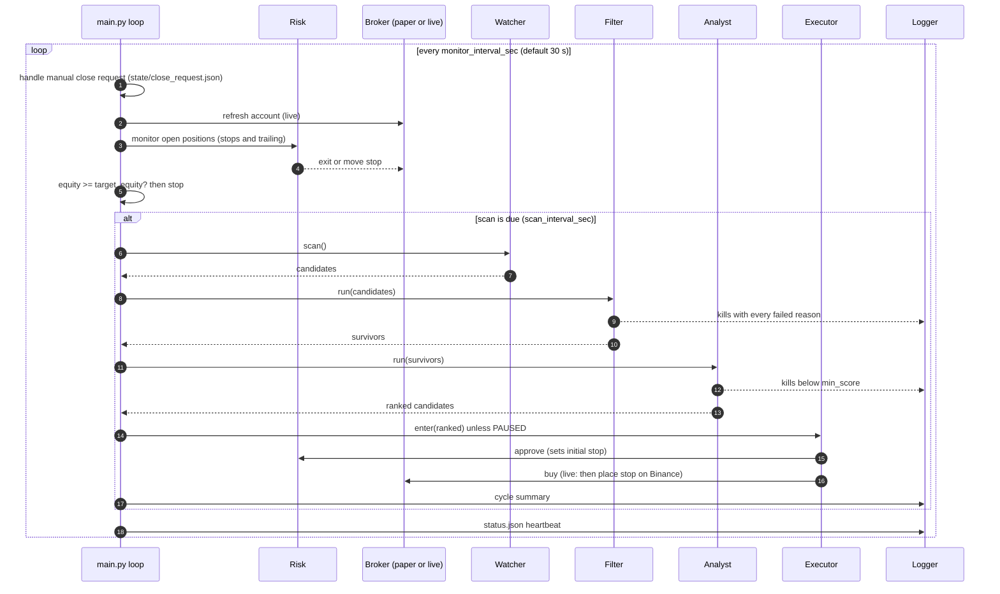

# Architecture

Crypto Desk is a single Python process (`main.py`) that runs a loop. Each pass of the loop is a **tick**; every
`scan_interval_sec` (default 300 s) a tick also runs a full **scan cycle** through the agents.

## Components

| Module | Role |
|--------|------|
| `main.py` | Argument parsing, single-instance lock, live opt-in gate, pre-flight, main loop, exit codes. |
| `desk/config.py` | Loads `config.toml` (or `config.example.toml`), selects the data directory, live opt-in helper. |
| `desk/data.py` | Public market data: Binance Spot REST, OKX/Gate/Binance funding rates, RSS news. |
| `desk/watcher.py` | Agent 1, builds candidates. |
| `desk/filter.py` | Agent 2, six safety checks. |
| `desk/analyst.py` | Agent 3, scoring. |
| `desk/executor.py` | Agent 4, sizing and entries (paper and live). |
| `desk/risk.py` | Agent 5, initial stop and trailing-stop logic. |
| `desk/logger.py` | Agent 6, structured logs, counters and `status.json`. |
| `desk/broker.py` | `PaperBroker`, simulated cash, positions and fills. |
| `desk/live.py` | `LiveBroker`, real orders, exchange-side stops, reconciliation, manual close, allowlist guard. |
| `desk/binance.py` | Minimal signed Binance REST client (HMAC-SHA256), exchange rules, retries, time sync. |
| `desk/preflight.py` | Live pre-flight checks. |
| `desk/keys.py` | Loads API keys from the environment, `.env` or `keys.txt`, and registers them for redaction. |
| `desk/control.py` | File-based control channel: close requests, results, pause flag. |
| `desk/util.py` | Atomic JSON writes, indicators (EMA, RSI), secret redaction, single-instance lock. |
| `deskctl.py` | CLI for close / pause / resume / status. |
| `visualizer.py` + `visualizer.html` | Local dashboard (standard-library HTTP server and a single HTML page). |

## Data directory

| Mode | Directory | Contents |
|------|-----------|----------|
| paper | `paper/` | `logs/`, `state/`, `status.json` |
| live | repository root | `logs/`, `state/`, `status.json` |

Paper and live files never mix. Everything in these folders is git-ignored.

### Files

| File | Written by | Purpose |
|------|-----------|---------|
| `status.json` | Logger | Heartbeat: mode, state, equity, cash, P&L, open positions, last cycle, data health, counters. |
| `logs/desk.log` | all | Human-readable log, with secrets redacted. |
| `logs/cycles.jsonl` | Logger | One line per scan cycle: candidates, survivors, ranking with factors, entry. |
| `logs/kills.jsonl` | Filter, Analyst, Executor | One line per rejected candidate, with every failed check, its value and threshold. |
| `logs/skips.jsonl` | all | Checks that could not run (for example a feed was down) and other non-fatal skips. |
| `logs/trades.jsonl`, `logs/trades.csv` | Logger | Every entry and exit, with price, quantity, fees, P&L and reason. |
| `state/state.json` (paper) | PaperBroker | Simulated cash and positions. |
| `state/live_state.json` | LiveBroker | Positions, stop order ids, pending entry, realised P&L. |
| `state/counters.json` | Logger | Cumulative counters. |
| `state/desk.lock`, `state/desk.pid` | main.py | Single-instance lock and process id. |
| `state/STOP` | you / STOP.bat | Requests a clean stop. |
| `state/PAUSE` | you / PAUSE.bat | No new entries; open positions are still managed. |
| `state/close_request.json`, `state/close_result.json` | deskctl / dashboard, desk | Manual close request and its answer. |
| `state/live_confirmed` | main.py | Records that you typed `YES` once. |
| `state/TARGET_REACHED` | main.py | Written when `target_equity` is reached; supervisors do not restart afterwards. |

## Exit codes

| Code | Meaning | Supervisor action |
|------|---------|-------------------|
| 0 | Stopped normally (STOP file, Ctrl+C, target reached, `--once`). | Do not restart. |
| 1 | Crashed or 20 consecutive tick errors. | Restart after a short delay. |
| 2 | A human must fix something (live disabled, bad keys, pre-flight failure, not confirmed). | Do not restart. |
| 3 | Temporary problem (network, clock, Binance unavailable). | Retry after about 60 s. |

## Live order lifecycle

1. **Plan.** `Executor.plan_live` checks that the buy **and** the protective stop both fit Binance's `LOT_SIZE`,
   `PRICE_FILTER` and `NOTIONAL` rules, with Binance's fee (paid in the coin) taken into account. If not, nothing is bought.
2. **Record intent.** `pending_entry` is written to `state/live_state.json` before the order is sent.
3. **Buy.** `MARKET` buy with `quoteOrderQty` and a `desk`-prefixed client order id.
4. **Protect.** The stop goes on the exchange immediately: `STOP_LOSS_LIMIT` (limit = stop − `stop_limit_buffer_pct`)
   or, with `stop_mode = "oco"`, an OCO with a far take-profit leg. If placing the stop fails after retries, the position is sold at market.
5. **Trail.** Each tick, the Risk agent tracks the peak from 1-minute candles. When the trailing stop should rise by at least
   `trail_min_step_pct`, the old stop is cancelled and a higher one is placed. If that fails, the position is sold at market.
6. **Exit.** A filled stop, a manual close or an emergency exit is recorded with its reason, and a re-entry cooldown starts.
7. **Reconcile.** On every start, `LiveBroker.reconcile` compares the saved state with real balances, open orders and order history,
   adopts a fill that happened during a crash, re-links or re-places missing stops, and records exits that happened while the desk was off.

## Safety mechanisms

- Live trading is gated by `[live] enabled = true` **and** `--mode live` **and** valid keys **and** a passing pre-flight **and** a one-time `YES`.
- API keys are never printed. `util.redact` removes registered secrets from every log line and error message.
- Single-instance lock prevents two desks from trading the same account.
- Allowlist guard (`LiveBroker._guard`) refuses any order for a symbol outside `allowed_symbols`, before it reaches Binance.
- Symbols rejected by Binance's own key whitelist (error −2010) are blocked for the session, so there are no retry loops.
- 20 consecutive tick errors make the desk exit, so the supervisor restarts it with a fresh pre-flight.
