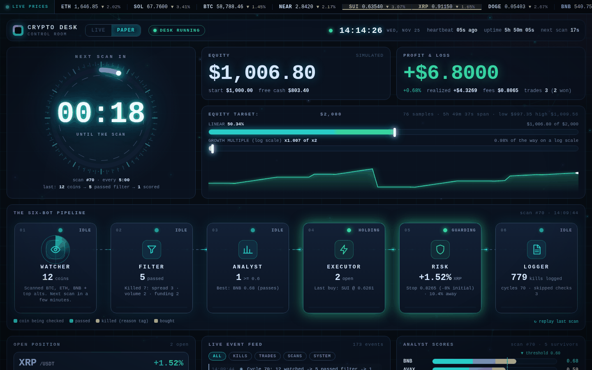
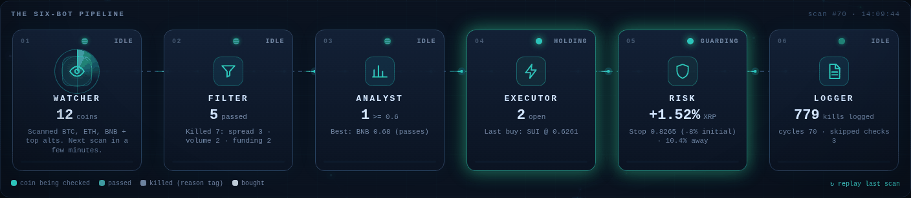
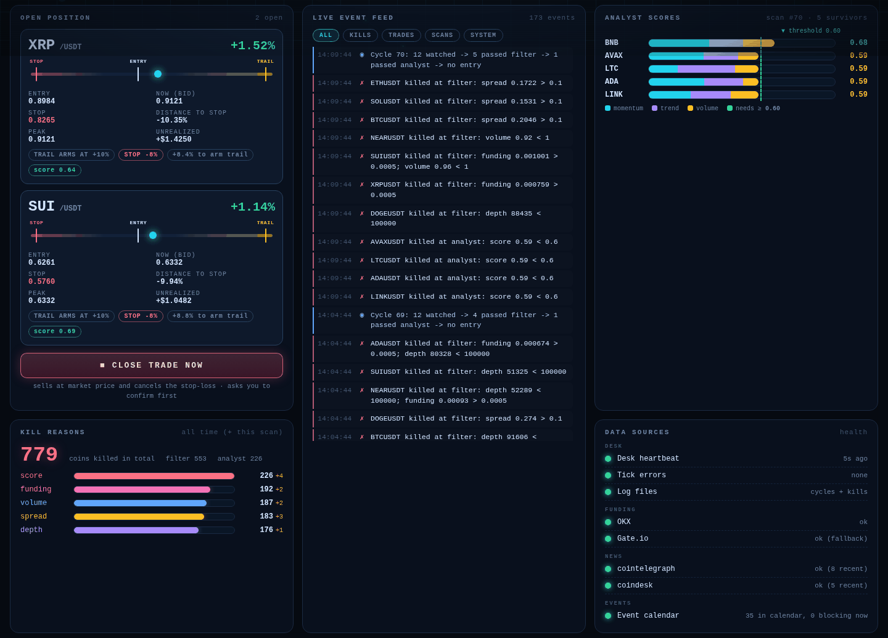
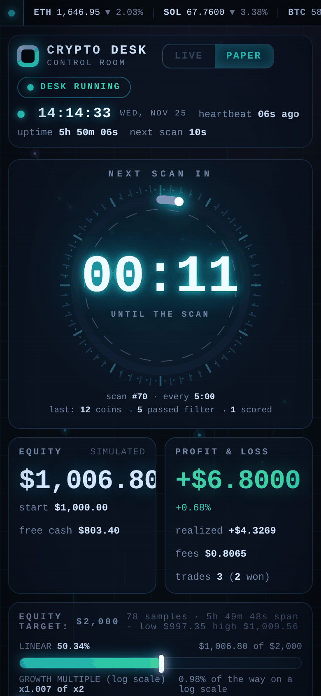
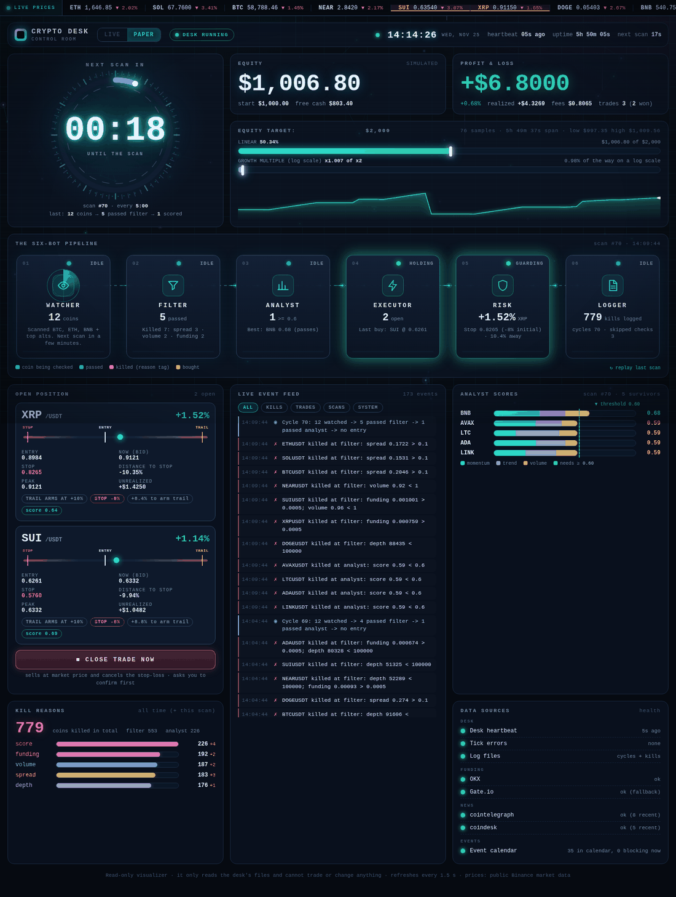

# Dashboard and manual controls

## Dashboard

`visualizer.py` serves a single page (`visualizer.html`) from a small standard-library HTTP server. It reads the desk's files
(`status.json`, `logs/*.jsonl`, `trades.csv`, `desk.log`) and never needs API keys.

```bash
python visualizer.py --mode paper --open      # windows\VISUALIZER.bat, scripts/visualizer.sh paper
```

It shows: desk state (running, paused, offline, stopped), equity and P&L, progress toward `target_equity`, open positions with stops,
the latest scan flowing through the six agents with the reasons for each rejection, recent trades, log lines, and a ticker tape of public prices.
It can be installed as an app window (Edge or Chrome app mode) and has a mobile layout.

| Option | Default | Description |
|--------|---------|-------------|
| `--host` | `127.0.0.1` | `0.0.0.0` makes it reachable from your local network (phone view). |
| `--port` | `8765` | HTTP port. |
| `--mode` | `auto` | `live`, `paper` or `auto` (the one with a fresh heartbeat). |
| `--live-dir`, `--paper-dir` | repository root, `paper/` | Data directories. |
| `--open` / `--tab` | off | Open an app window or a normal browser tab. |
| `--allow-control` | off | With `--host 0.0.0.0`: allow the close button from the network, with a one-time token printed in the console. |
| `--no-control` | off | Remove the close button entirely (fully read-only). |

### Security model

- By default it listens on loopback only.
- The only state-changing endpoint is `POST /api/close`. It requires a custom `X-Desk-Control` header and a same-origin `Origin`,
  and the request must come from loopback with a loopback `Host` header (which blocks DNS rebinding). From the network it also needs `--allow-control` and the token.
- On `0.0.0.0`, **anyone on the same network can see your balance and trades**. Use it only on a network you trust.

## Screenshots

All screenshots show **paper mode with made-up demo data** (simulated 1,000 USDT starting balance). They are not real trading results.
The ticker tape at the top shows public market prices from the moment of capture.



**Six-agent pipeline.** Each scan flows through Watcher, Filter, Analyst, Executor, Risk and Logger. Every card shows what that agent did in the last scan.



**Positions, event feed and analysis.** Open positions with entry, stop, trailing level and the close button; a filterable feed of cycles, rejections and trades;
analyst scores per factor; all-time rejection reasons; and the health of every data source.



**Phone view.** The layout adapts to small screens. Use `windows\VISUALIZER-PHONE.bat` or `--host 0.0.0.0` on a trusted Wi-Fi network.

<p align="center"></p>

<details>
<summary>Full-page desktop screenshot</summary>



</details>

## Manual controls

| Action | Effect | Command |
|--------|--------|---------|
| Stop | Clean shutdown. **Nothing is sold**; live stops stay on Binance. | `windows\STOP.bat`, `scripts/stop.sh`, or create `state/STOP` |
| Pause | No new entries; scanning and risk management continue. | `windows\PAUSE.bat`, `python deskctl.py pause --mode live` |
| Resume | Allow new entries again. | `windows\RESUME.bat`, `python deskctl.py resume --mode live` |
| Close now | Sell open desk positions at market (asks for `YES`; can pause afterwards). | `windows\CLOSE-TRADE.bat`, `python deskctl.py close --mode live [--symbol SOLUSDT] [--pause-after]`, or the dashboard button |
| Status | Print a summary of `status.json`. | `windows\STATUS.bat`, `python status.py` / `python status.py paper` |

How *close now* works: if the desk is running, `deskctl.py` writes `state/close_request.json`; the desk answers within about a second
in `state/close_result.json`. If the desk is not running, `deskctl.py` takes the lock and closes directly. Requests older than 15 minutes
are ignored. For each position: if the stop has already filled, that is recorded and nothing is sold; otherwise the stop is cancelled and the
free quantity is sold at market. If the sell fails, the stop is placed again.
